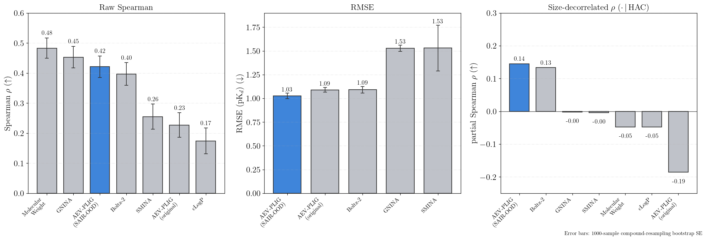

# On improving experimental binding affinity predictions with synthetic data

Code and data accompanying the paper *"On improving experimental binding affinity
predictions with synthetic data."*

We extend the Structurally Augmented IC50 Repository (SAIR) with docking scores and
~80,000 absolute free-energy perturbation (AFEP/AQFEP) calculations, and study how
this synthetic structural data improves binding-affinity models — both sequence-based
proteochemometric (PCM) models and the structure-based AEV-PLIG network.

## Highlight: generalization to a new target (OpenBind EV-A71 2A)

On the recent, fully out-of-distribution [OpenBind](https://openbind.org) EV-A71 2A
protease benchmark — a target absent from training (closest training protein shares
only 47% sequence identity) — training AEV-PLIG on synthetic (SAIR-OOD) **plus**
experimental data yields the **lowest RMSE of any AI- or physics-based method in the
benchmark** and a **1.85× improvement in Spearman ranking** over the original
experimental-only AEV-PLIG.

<p align="center">
  
</p>

Raw Spearman is confounded by molecular size on this fragment-elaboration series;
after decorrelating for heavy-atom count (right panel), our model retains the
strongest size-independent ranking of any method tested.

## Repository layout

```
data/     Docking + AFEP values (zipped CSVs) — see data/README.md for the full data dictionary
scripts/  Reproduction code (PCM pipeline, per-target local models, AEV-PLIG source-embedding patch)
```

## Data

| File | Rows | Description |
|------|------|-------------|
| [`data/docking_and_afep_data_sair.csv.zip`](data/docking_and_afep_data_sair.csv.zip) | 98,235 | Gnina/Vina/Vinardo docking scores and AQFEP binding free energies for the SAIR co-folded complexes (81,761 with AFEP ΔG), plus experimental affinity and co-folding confidence. |
| [`data/PDBBind_AQFEPscore.csv.zip`](data/PDBBind_AQFEPscore.csv.zip) | 14,984 | AQFEP absolute binding free energies computed on PDBbind complexes, with experimental potency/pK. |

Every column is documented in [`data/README.md`](data/README.md). The underlying
co-folded structures are from SAIR (Lemos et al.); this repository provides the
docking and free-energy calculations layered on top of them.

## Scripts

| Script | Purpose |
|--------|---------|
| [`scripts/pcm_pipeline.py`](scripts/pcm_pipeline.py) | Self-contained PCM training/inference pipeline (RandomForest, Mean-Variance Estimator, and Gaussian Mixture Network models) with Bayesian hyperparameter optimization. Supports appending physics-based features (docking, AFEP) and ESM-2 protein embeddings. |
| [`scripts/run_local_models_sair_fep_opt.py`](scripts/run_local_models_sair_fep_opt.py) | Trains the per-protein "local" baselines (AFEP-Linear and XGBoost on Morgan fingerprints) on the SAIR-FEP-OPT split, reproducing those curves in the lead-optimization figure. |
| [`scripts/apply_patch.sh`](scripts/apply_patch.sh) + [`scripts/patches/`](scripts/patches/) | Clones [AEV-PLIG-refined](https://github.com/weitse-hsu/AEV-PLIG-refined) and applies the source-embedding patch so the model routes a per-complex `dataset_idx` (0 = experimental, 1 = synthetic) through its embedding, enabling simultaneous training on experimental and synthetic data. |

### PCM models
```bash
python scripts/pcm_pipeline.py train \
    --train-csv <train.csv> --target-col potency \
    --smiles-col SMILES --protein-col sequence \
    --protein-feature-table <esm2_embeddings.parquet> \
    --extra-feature-cols <docking/AFEP columns> \
    --models GMN MVE RF --metric spearman --output-dir workspace/
```

The saved `workspace/pipeline.pkl.gz` is a pickle; only run `predict` on
workspaces you trust (see [SECURITY.md](SECURITY.md)).

### Per-target local baselines (SAIR-FEP-OPT)
```bash
python scripts/run_local_models_sair_fep_opt.py \
    --train-csv <sair_fep_opt_train.csv> \
    --test-csv  <sair_fep_opt_test.csv> \
    --output-dir <output_dir> --min-ligands 10
```

### AEV-PLIG with the source embedding
```bash
bash scripts/apply_patch.sh   # clones AEV-PLIG-refined and applies the dataset_idx patch
```

## Citation

If you use this code or data, please cite the accompanying paper, and SAIR
(Lemos et al.) for the underlying co-folded structures.

> Ryczko, K., Zin, P. P., Crivelli-Decker, J., Le, L., Jha, P. K., Shields, B. J.,
> Lemos, P., Bandi, S., van Damme, M., Sood, A., Huntington, L., Pitman, M.,
> Ganahl, M., & Bortolato, A. (2026). *On improving experimental binding affinity
> predictions with synthetic data.* bioRxiv.
> https://doi.org/10.64898/2026.03.02.708607

A machine-readable citation is available in [CITATION.cff](CITATION.cff).

## License

See [LICENSE](LICENSE).
